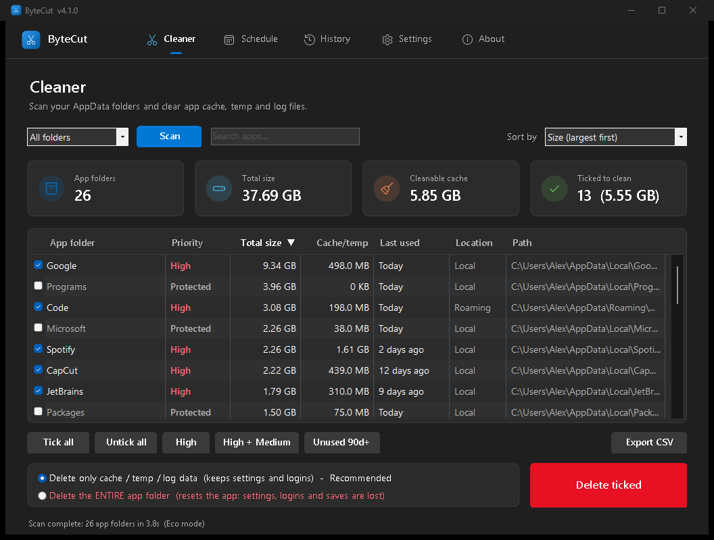

<p align="center">
  
</p>

<h1 align="center">ByteCut</h1>

<p align="center">
  <b>The AppData cleaner for Windows.</b> Free up disk space by clearing the cache, temp and log files that apps leave in <code>AppData</code>.<br>
  Safe by default, low on CPU, and it can run on a weekly schedule.
</p>

<p align="center">
  
  
  
  
</p>

<p align="center">
  
  
</p>

---

## Why?

Browsers, chat apps, editors and games keep gigabytes of cache in
`C:\Users\<you>\AppData`. Windows' own Disk Cleanup doesn't touch most of it. ByteCut shows
you **which apps use how much**, ranks them by how much is worth cleaning, and removes only the
throw-away parts (cache, temp, logs, crash dumps), so your settings and logins stay.

## Features

| | |
|---|---|
| **See everything** | Scans `Local`, `Roaming` and `LocalLow` (or all at once). Shows every app with total size, cache size, last-used date and location. |
| **Smart priorities** | **High** (100 MB+ cache), **Medium** (10 MB+), **Low**, **None**, plus **Protected** for Windows folders and **Excluded** for apps you never want touched. |
| **Sort and search** | Click any column, or use *Sort by*: size, cache size, priority, last used (find abandoned apps) or name. Search box and tooltips. |
| **Safe cleaning** | Default mode empties only cache/temp/log folders. The optional *entire folder* mode resets an app and always refuses Windows folders. Confirmation every time. |
| **Weekly schedule** | Pick days and a time. Get a **notification** ("2.1 GB can be cleaned") or let it **clean automatically** by priority, optionally only apps unused for N days. Can run *only when plugged in* or *only when idle*. |
| **Low CPU** | **Normal**, **Eco** and **Power saver** modes. Eco and Power saver use low priority, a work/rest duty cycle and Windows 11 **Efficiency mode**. |
| **Fast** | Native scanner (Win32 `FindFirstFileEx`) with up to 8 threads sharing one queue of folders. About 212,000 files in 3.5 s. |
| **History** | Total data cleaned so far, cleanups this month, and every cleanup (manual or scheduled) with space freed. |
| **Fluent design** | Windows 11 look: top navigation bar, light and dark theme (or follow Windows), crisp Segoe UI text that stays sharp at any display scaling, rounded window. Every page opens in under 100 ms, with no animations to wait for. |
| **Windows temp cleaner** | Built in (Settings > Other tools): clears Windows temp files, crash dumps, internet and thumbnail caches, and with administrator also Windows Temp, the Windows Update cache and error reports. Optional boost: flush DNS, release unused RAM, SSD TRIM. Also from the command line: `ByteCut.exe --tempclean [--system] [--boost]`. |
| **Extras** | Never-clean list (right-click > *Never clean this app*), CSV export, *Install to this PC* with Start Menu + Desktop shortcuts. |
| **Tiny** | One ~100 KB `.exe`, no installer, no admin rights, no internet, no telemetry. |

## Download and run

1. Download **`ByteCut.exe`** from the [Releases](../../releases) page.
2. Double-click it. No installation or admin rights needed.
3. *(Optional)* **Settings > Install to this PC** copies it to your user Programs folder and adds shortcuts.
   Recommended if you use the schedule.

> Upgrading from **AppData Cleaner 3.0**? ByteCut copies your settings and history automatically. Re-save the schedule once so the task points at `ByteCut.exe`.

> **"Windows protected your PC"?** The .exe is not code-signed, so SmartScreen may warn the first
> time. Click **More info > Run anyway**, or build it yourself from source (see below). The SHA-256
> checksum of every release is published next to the download.

**Requirements:** Windows 10 or 11 with Windows PowerShell 5.1 and .NET Framework 4.x (both built in).

## How to use

1. Choose **Local**, **Roaming**, **LocalLow** or **All folders** and press **Scan**.
2. Sort by **Priority** or **Cache size**, then tick apps (or use **High** / **High + Medium**).
3. Close those apps, keep **"Delete only cache / temp / log data"** selected and press **Delete ticked**.

The full walkthrough is in the **[User Guide](docs/USER_GUIDE.md)**.

<p align="center">
  
  
</p>

## Performance

Measured with [`tests/StressTest.ps1`](tests/StressTest.ps1) and on a real AppData folder
(250,000 files, 32 GB, Windows 11, 12 logical cores):

| Mode | Real folder scan | CPU used | What it does |
|---|---|---|---|
| **Normal** | ~3.5 s | several cores, briefly | Native scanner, up to 8 threads sharing one folder queue |
| **Eco** (default) | ~30 s | ~60-70 % of one core | Below-normal priority, 30 ms work / 15 ms rest, Efficiency mode on the scan thread |
| **Power saver** | ~80 s | ~30 % of one core | Lowest priority, 15 ms work / 30 ms rest, Efficiency mode |

Scheduled runs use the same mode, and can be limited to *plugged in* and *idle* time.

## Safety

ByteCut is careful by design, and each point below is covered by the stress test:

- **Cache-only by default.** Only folders named like `Cache`, `Code Cache`, `GPUCache`, `Temp`,
  `Logs`, `Crashpad` and similar are emptied, and the folders themselves are kept.
- **Never follows junctions or symlinks**, so a link can't lead it outside AppData.
- **Hard path guard:** it refuses to delete anything that isn't strictly inside an AppData folder,
  and never touches `Downloads`.
- **Protected list:** `Microsoft`, `Packages`, `Programs`, `Temp` and other Windows folders are
  never deleted whole and never picked by the schedule.
- **Scheduled cleaning is always cache-only.** It never deletes whole folders.
- Files that are in use are skipped. Nothing is sent anywhere.

## Build from source

Nothing to install: the build uses the C# compiler that ships with Windows.

```powershell
git clone https://github.com/mishuk-11/ByteCut.git
cd ByteCut
powershell -ExecutionPolicy Bypass -File build\Build.ps1      # runs the stress test, then builds dist\ByteCut.exe
```

Run without building: double-click **`Run from source.bat`**, or

```powershell
powershell -ExecutionPolicy Bypass -File src\ByteCut.ps1
```

Developer docs (architecture, release checklist, gotchas): **[docs/DEVELOPMENT.md](docs/DEVELOPMENT.md)**.

## Project structure

```
ByteCut/
├── src/
│   ├── ByteCut.ps1          Desktop app (Fluent UI, light/dark themes, pages, background jobs, scheduled mode)
│   ├── Core.ps1             Engine: scan, priorities, clean, temp cleaner, settings, history, Task Scheduler
│   └── Native.cs            Fast native scanner, Efficiency mode, window chrome and list theming
├── launcher/Launcher.cs     The .exe: hosts PowerShell and runs the embedded scripts
├── build/
│   ├── Build.ps1            Test + compile dist\ByteCut.exe
│   ├── New-Icon.ps1         Draws assets\app.ico
│   └── Take-Screenshots.ps1 Makes docs\screenshots (demo data)
├── tests/StressTest.ps1     Stress, performance and safety test (34 checks)
├── assets/                  Icon
├── docs/                    User guide, developer guide, screenshots
└── Run from source.bat
```

## Command line

```
ByteCut.exe                              open the app
ByteCut.exe --tempclean                  clean user temp files, then show a notification
ByteCut.exe --tempclean --system         also system temp (asks for administrator once)
ByteCut.exe --tempclean --boost          also flush DNS, release unused RAM, SSD TRIM
ByteCut.exe --scheduled                  what the weekly schedule runs
```

## Settings and data

Stored in `%APPDATA%\ByteCut\` (`settings.json`, `history.json`). The weekly schedule is a
normal Windows Task Scheduler task named **"ByteCut - Scheduled Clean"** in your user
account. Turning the schedule off removes it.

## License

[MIT](LICENSE) © 2026 **Inzamam Islam**

<p align="center"><sub>Developed by Inzamam Islam</sub></p>
