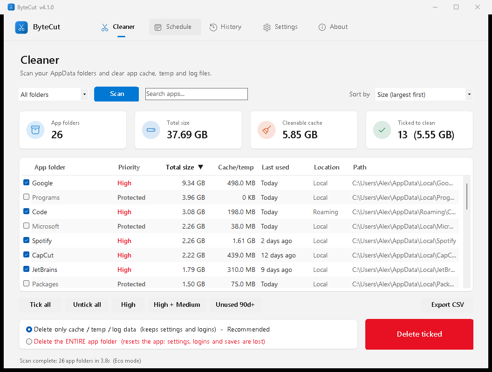
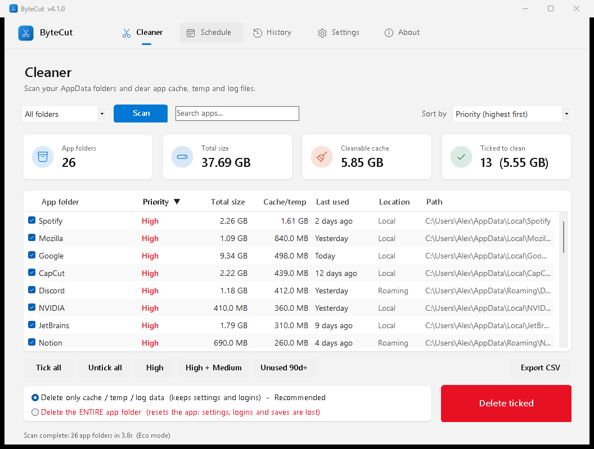
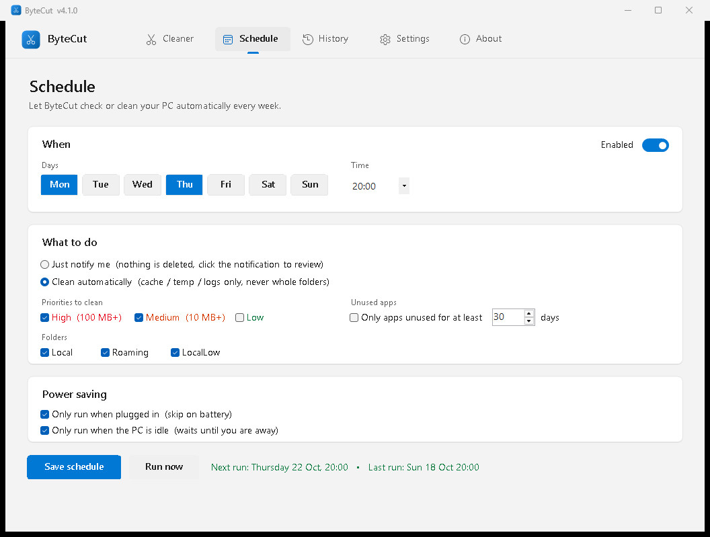
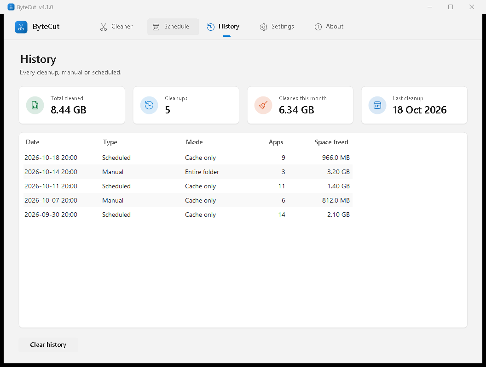
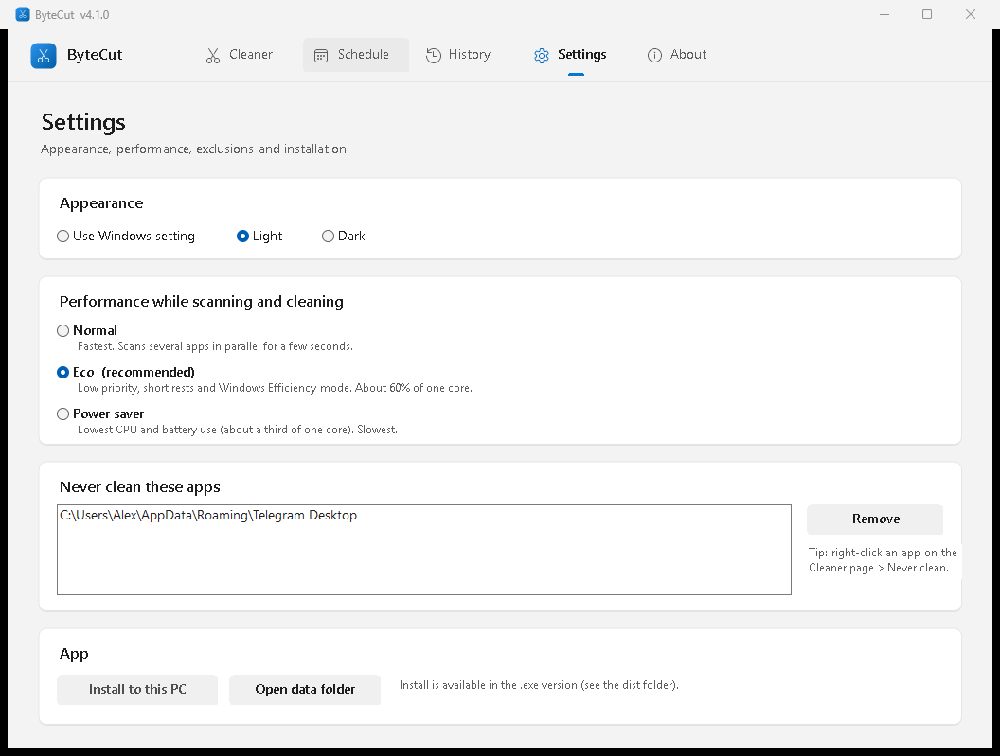

# ByteCut: User Guide

Version 4.2.0 · Developed by Inzamam Islam

Use the tabs in the **top bar** (Cleaner, Schedule, History, Settings, About) to move between pages.

- [1. What AppData is and what gets cleaned](#1-what-appdata-is-and-what-gets-cleaned)
- [2. Cleaner page](#2-cleaner-page)
- [3. Schedule page](#3-schedule-page)
- [4. History page](#4-history-page)
- [5. Settings page](#5-settings-page)
- [6. FAQ and troubleshooting](#6-faq-and-troubleshooting)

---

## 1. What AppData is and what gets cleaned

Every Windows user has a hidden folder `C:\Users\<you>\AppData` with three parts:

| Folder | Typical content |
|---|---|
| **Local** | Big caches: browsers, Spotify, editors, GPU shader caches, game launchers |
| **Roaming** | Settings and profiles that follow you (Discord, VS Code, Slack, Zoom...) |
| **LocalLow** | Low-trust apps, mostly games (Unity, Java) |

Inside each app's folder, ByteCut looks up to 6 levels deep for these **cache folder names**:

`Cache`, `Cache2`, `CachedData`, `Code Cache`, `GPUCache`, `DawnCache`, `DawnGraphiteCache`,
`DawnWebGPUCache`, `GrShaderCache`, `ShaderCache`, `CacheStorage`, `ScriptCache`, `INetCache`,
`D3DSCache`, `Temp`, `Tmp`, `Logs`, `Log`, `CrashDumps`, `Crashpad`, `Crash Reports`, `crashes`

Apps re-create these automatically. The first start after cleaning may be a little slower while
the cache rebuilds.

## 2. Cleaner page

### Scanning
1. Pick **Local**, **Roaming**, **LocalLow** or **All folders**.
2. Press **Scan**. The window stays usable while it scans. Press **Stop** to cancel.
3. The scan speed depends on the performance mode (Settings). The status line shows the time taken.

### The summary boxes
- **App folders**: how many were found.
- **Total size**: everything, including settings and data.
- **Cleanable cache**: cache/temp/log data in apps that are not Protected or Excluded.
- **Ticked to clean**: how many apps are ticked and how much cache they hold.

### The table
| Column | Meaning |
|---|---|
| App folder | Folder name. Hover for the full path and file count. |
| Priority | **High** 100 MB+ cache · **Medium** 10 MB+ · **Low** under 10 MB · **None** no cache found · **Protected** Windows folder · **Excluded** on your never-clean list |
| Total size | Everything in the folder |
| Cache/temp | The part that can be cleaned safely |
| Last used | Newest file change. **Orange** = 90+ days, often a leftover of an uninstalled app. |
| Location | Local / Roaming / LocalLow |
| Path | Full path |

**Sorting:** click a column header (click again to reverse, the arrow shows the direction) or
use **Sort by**. Your choice is remembered.

**Right-click a row:** *Open folder*, *Copy path*, *Never clean this app* (or *Allow cleaning
this app again*). **Double-click** opens the folder.

### Ticking apps
- **Tick all / Untick all**: every visible row (Protected and Excluded are skipped by *Tick all*).
- **High**, **High + Medium**: by priority.
- **Unused 90d+**: apps with no file changes for 90 days. Best combined with *entire folder*
  mode to remove leftovers of apps you uninstalled.
- The **search box** filters by name or path. Ticks are kept while you search or sort.

### Deleting
- **Delete only cache / temp / log data (recommended):** empties the cache folders listed above.
  Settings, logins and saves stay.
- **Delete the ENTIRE app folder:** removes everything for that app, like a fresh install.
  Protected folders are always refused. Use it for apps you no longer have.

Close the apps first: files in use are skipped. A confirmation lists every app before anything is
deleted. Deleted files do **not** go to the Recycle Bin.

**Export CSV** saves the current table (sorted) for Excel or Google Sheets.

## 3. Schedule page

1. Switch **Enabled** on.
2. Choose the **days** and **time**.
3. **What to do:**
   - **Just notify me**: scans, then shows a Windows notification such as *"2.1 GB of cache/temp
     data in 12 apps"*. Click it to open the app with the results. Nothing is deleted.
   - **Clean automatically**: cleans **cache / temp / logs only** (never whole folders) of apps that
     match your rules, then shows how much was freed.
4. **Priorities to clean:** High, Medium and/or Low.
5. **Only apps unused for at least N days:** limits it to apps you haven't used recently.
6. **Folders:** which AppData folders to include.
7. **Power saving:**
   - *Only run when plugged in*: skipped on battery (and stopped if you unplug).
   - *Only run when the PC is idle*: waits until you have been away for 5 minutes.
8. Press **Save schedule**. The next run time is shown next to the buttons.

**Run now** does a dry run of your rules immediately, shows exactly which apps and how much, and
asks before cleaning.

If the PC is off at the scheduled time, the task runs as soon as possible afterwards.

> The schedule starts the .exe from where it is. If you move or delete the .exe, use
> **Settings > Install to this PC** and save the schedule again.

## 4. History page

Four boxes at the top: **Total cleaned** (everything ByteCut has freed so far), **Cleanups**,
**Cleaned this month** and **Last cleanup**. Below them is a list of every cleanup, manual or
scheduled, with the date, mode, number of apps and space freed. **Clear history** empties the list
(it does not undo anything).

## 5. Settings page

### Appearance
**Use Windows setting** (default) follows your Windows light/dark mode. **Light** and **Dark**
force a theme. The change applies immediately.

### Performance
| Mode | Use it when |
|---|---|
| **Normal** | You want results fast. Up to 8 threads share the work; finishes in a few seconds. |
| **Eco** (default) | Everyday use. Low priority, rests a third of the time, Windows Efficiency mode. |
| **Power saver** | On battery, or while gaming or working. About a third of one core, slowest. |

The mode is used for manual scans, cleaning and scheduled runs.

### Other tools: Windows temp cleaner
Cleans temporary files outside AppData. Downloads is never touched, and files in use are skipped.

| Option | What it cleans |
|---|---|
| *(always)* | Your temp folder (%TEMP%), crash dumps, internet cache, thumbnail cache |
| **Include system temp** | Also Windows Temp, the Windows Update download cache, error reports and the Delivery Optimization cache. Windows asks for administrator permission once. |
| **Boost** | Flushes the DNS cache, releases unused RAM from running programs, and runs SSD TRIM on C: (TRIM needs administrator) |

Press **Clean temp files**. A summary shows what was freed, and the cleanup is added to History.
The same cleaner works from the command line: `ByteCut.exe --tempclean [--system] [--boost]`.

### Never clean these apps
Apps you excluded with right-click > *Never clean this app*. They show as **Excluded**, are skipped
by every tick button and by the schedule, and are refused if you tick them by hand. Select one and
press **Remove** to allow cleaning again.

### App
- **Install to this PC** (.exe only): copies the app to
  `%LOCALAPPDATA%\Programs\ByteCut` and creates Start Menu and Desktop shortcuts. If a
  schedule is active, it is moved to the installed copy.
- **Open data folder**: `%APPDATA%\ByteCut` with `settings.json` and `history.json`.

## 6. FAQ and troubleshooting

**Is it safe to delete cache?**
Yes. Cache is a copy of data that apps can download or rebuild. You might need to wait a moment
the next time you open the app. Logins and settings live outside the cache folders.

**Why are some files left after cleaning?**
They were in use. Close the app (check the system tray too) and clean again.

**SmartScreen says "Windows protected your PC".**
The .exe is not code-signed. Click *More info > Run anyway*, or build it yourself with
`build\Build.ps1`. You can check the download against the `.sha256` file on the release page.

**My antivirus flags the .exe.**
Some antivirus tools are suspicious of programs that host PowerShell. The full source is in this
repository. You can build it yourself, or run `src\ByteCut.ps1` directly.

**How do I uninstall?**
Turn the schedule off (Schedule > Enabled off > Save), delete the .exe (or
`%LOCALAPPDATA%\Programs\ByteCut` and the shortcuts), and optionally `%APPDATA%\ByteCut`.

**Does it need admin rights or the internet?** No and no.
